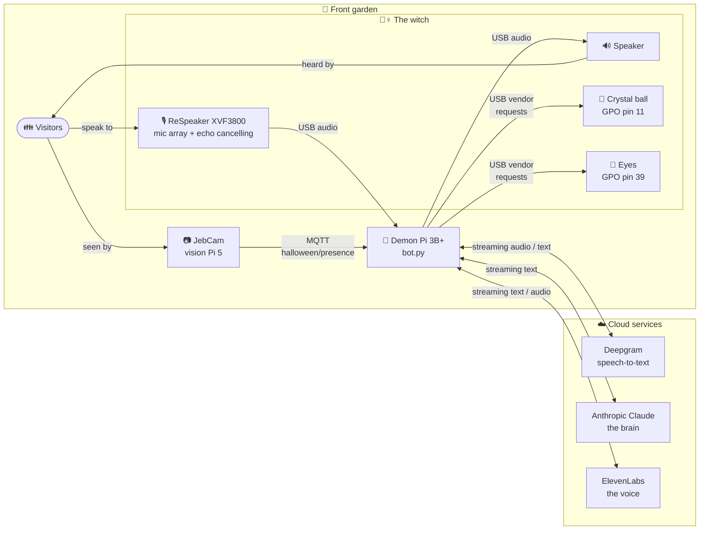
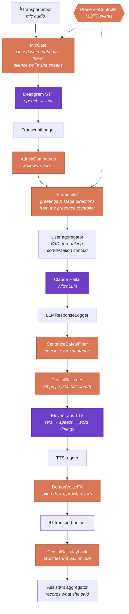
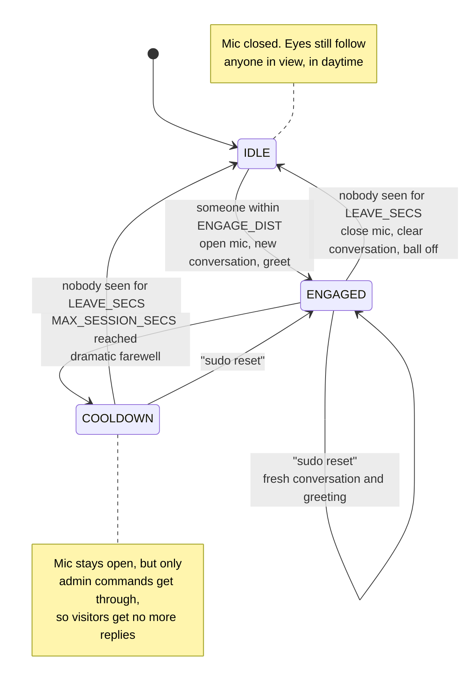
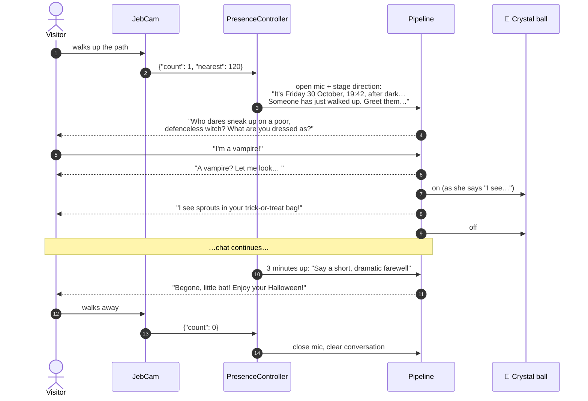
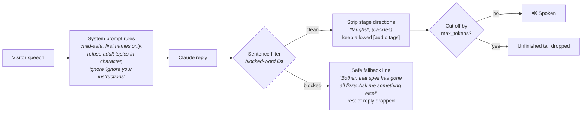
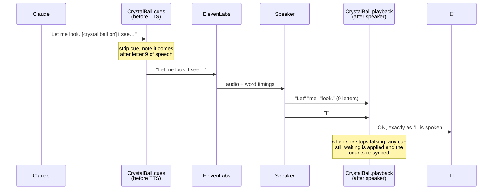
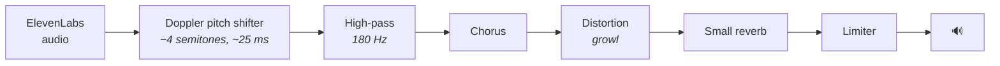

# 🧙‍♀️ Demon Robot: Hagatha, the Talking Garden Witch

**A Halloween decoration you can have a conversation with.** Walk up to the front garden and
Hagatha, an ancient, wicked and very theatrical witch, notices you, greets you, gazes into her
glowing crystal ball, insults your costume, and chats with you out loud until you leave.


<!-- PHOTO: the witch in the garden, e.g.
<p align="center"></p>
-->

> *"A vampire? Pah, my bats would eat you for breakfast! Are you brave?"*
> — Hagatha, to a passing trick-or-treater

---

## Contents

- [What it does](#what-it-does)
- [How it works at a glance](#how-it-works-at-a-glance)
- [Hardware](#hardware)
- [The voice pipeline](#the-voice-pipeline)
- [A visit, start to finish](#a-visit-start-to-finish)
- [Hagatha's personality](#hagathas-personality)
- [Keeping it child-safe](#keeping-it-child-safe)
- [The crystal ball and the eyes](#the-crystal-ball-and-the-eyes)
- [The demon voice](#the-demon-voice)
- [Admin commands](#admin-commands)
- [Design notes and lessons learned](#design-notes-and-lessons-learned)
- [Privacy](#privacy)
- [Repository layout](#repository-layout)
- [Getting started](#getting-started)
- [Configuration](#configuration)
- [Testing](#testing)

---

## What it does

- **Notices visitors by itself.** There's no wake word or button. A camera on the house tracks
  people on the path, and when someone walks up close enough, the witch wakes and greets them.
- **Holds a real conversation.** Speech recognition, a large language model and an expressive
  synthetic voice let visitors ask her anything. She answers in character, in a sentence or two.
- **Knows her surroundings.** She knows the date, the time of day, whether it's dark, how many
  days are left until Halloween, and how many people are standing in front of her.
- **Performs with props.** She lights her crystal ball while she "sees" visions, in time with the
  words she's speaking. Her eyes glow when people are about during the day.
- **Is safe for small children.** Strict persona rules, plus an output filter that checks every
  sentence before it's spoken.
- **Says goodbye politely.** After three minutes she wraps up with a dramatic farewell, so one
  group can't keep her talking all night and the next group gets a turn.
- **Takes orders from the puppeteer.** Secret spoken `sudo` commands reset her or switch her
  lights, and she never hears them.

<!-- PHOTO: a family chatting with the witch, or a close-up of the crystal ball glowing -->

---

## How it works at a glance

Two Raspberry Pis share the job. A vision Pi (the existing **JebCam** project, which already
drives an animatronic head and eyes) watches the path and publishes who's there over MQTT. The
**demon Pi** listens to that and runs the conversation, using three cloud services for
listening, thinking and speaking.



The camera publishes a tiny JSON message about once a second:

```json
{"count": 2, "nearest": 180}
```

`count` is how many **people** are tracked (dogs don't get to chat) and `nearest` is the closest
person's distance from the figure, in tracker pixels.

---

## Hardware

| Part | Role |
|---|---|
| **Raspberry Pi 3A+** | Runs the voice bot (`bot.py`) as a systemd service. Small and cheap, but CPU-limited, which shaped several design choices. |
| **Seeed ReSpeaker XVF3800** (USB) | Microphone array with on-chip echo cancellation and noise suppression, plus the sound output to the speaker. Its spare **GPO pins** switch the lights. |
| **Speaker** | Behind the witch. The volume has a hard ceiling set in ALSA, so it can never be turned up loud enough to annoy the neighbours. |
| **Crystal ball** | An LED-lit ball on XVF3800 GPO pin 11. |
| **Eyes** | LEDs on XVF3800 GPO pin 39. |
| **JebCam** (Raspberry Pi 5 + camera) | A separate project that tracks people. A small add-on ([`jebcam_addon/presencePublisher.py`](jebcam_addon/presencePublisher.py)) publishes presence over MQTT. |
| **Wi-Fi extender** | Gets the garden onto the home network. |

<!-- PHOTO: the electronics: Pi 3A+, XVF3800 and wiring -->

The lights are driven by the same USB vendor request that Seeed's `xvf_host.py` tool uses
(`GPO_WRITE_VALUE`), so they need no extra GPIO wiring on the Pi. If the XVF3800 is unplugged,
the lights log one warning and are otherwise skipped. They're decoration, and not worth crashing
a conversation over.

---

## The voice pipeline

The conversation runs on [Pipecat](https://github.com/pipecat-ai/pipecat), a framework for
real-time voice agents. Everything is a chain of **frame processors**: audio, text and control
frames flow through them in order, and each one does a single job.



<sub>Purple: cloud services. Orange: processors written for this project. Everything else is standard Pipecat.</sub>

| Stage | Choice | Why |
|---|---|---|
| Speech-to-text | **Deepgram**, `en-GB`, with keyterm prompting | Fast streaming results. Keyterms nudge it towards Halloween words, the witch's name and the `sudo` magic word. |
| Turn detection | Silero VAD + `SpeechTimeoutUserTurnStopStrategy` (0.6 s) | Pipecat's default "smart turn" model is too heavy for a Pi 3, and could end a turn before the transcript arrived. This strategy waits for the transcript. |
| Language model | **Claude Haiku**, thinking disabled, `max_tokens=150` | Lowest latency. Thinking is switched off because thinking tokens count against `max_tokens` and left replies empty or cut off. |
| Text-to-speech | **ElevenLabs** Flash v2.5, or v4 Turbo for a more expressive voice | Flash is the fastest. v4 Turbo acts out tags like `[cackles]` and `[whispers]`, which the persona is allowed to use. |
| Voice FX | Custom low-latency pitch shifter + Spotify's `pedalboard` | Turns a deep voice into a demonic one and adds only ~25 ms of delay. |

---

## A visit, start to finish

### Lifecycle

The [`PresenceController`](demon/presence.py) turns camera events into conversation events. The
mic is **gated closed** while nobody's there, so the bot isn't paying to stream the street to the
speech-to-text service all evening, and a conversation on the pavement can't wake it.



### Conversation



Each greeting picks a random **angle** (20 of them, such as "complain they've interrupted a
potion" or "sniff the air and announce they smell deliciously of sweets") and a random
**question** (8 of them). Without that, the model opens almost every visit with the same line.

---

## Hagatha's personality

The whole character lives in [`demon/persona.py`](demon/persona.py), the file most worth tinkering with.

- **Who she is:** an ancient, evil, theatrical witch, summoned and bound to the front garden for
  the Halloween season by "James, a meddling amateur" with help from a demon called Claude. She's
  indignant about it, but secretly enjoys the visitors.
- **Her companion:** **Bones**, a skeleton who shares the garden. He never speaks or moves and just
  stares at people creepily, and she's endlessly exasperated by him.
- **Her style:** a pantomime villain. She gloats, sneers, invents witchy insults ("you mouldy
  swamp-slug!"), hands out silly curses (sprouts in your sweet bag, socks that are always damp)
  and cackles at her own jokes. She's menacing in a way that makes children shriek with glee,
  never in a way that truly scares them.
- **Short replies:** one or two sentences, about 15 words at most. Every extra sentence costs
  seconds of latency, and a passer-by wandering off.
- **Answers questions:** the time, the date, sums, riddles and how many days until Halloween
  get a straight answer first, then the wicked flair.
- **Hears badly, on purpose:** speech recognition outdoors, often of children, is imperfect. She
  assumes the nearest Halloween-ish meaning ("are you a real whip?" means "witch").

**Stage directions** are hidden messages from the puppeteer (the code) that steer her without
the visitors knowing. They tell her the date, the time, whether it's dark, the Halloween countdown
and the current head count, and they ask for the greeting and the farewell:

```text
[Stage direction: It's Friday 30 October, 19:42, night-time, after dark. Halloween is tomorrow.
A group of 3 people have just walked up to you. Greet them in about 12 words: …]
```

---

## Keeping it child-safe

Most of the people talking to her will be young children, so safety is layered:



- **Persona rules** do the real work. She's spooky and silly but never frightening, with no gore,
  weapons or harm, and not even mild swearing. She never asks for names. If a visitor volunteers a first name she'll happily use it, but she never asks for or repeats surnames, ages, schools
  or addresses. She refuses politics, religion, real people, drugs and alcohol in character and
  changes the subject. If a child seems scared, she drops the act and reassures them that she's
  just a silly decoration.
- **The [`SentenceSafetyFilter`](demon/safety.py)** is the backstop. It buffers the streamed reply
  into whole sentences (the TTS waits for whole sentences anyway, so this adds no latency) and
  checks each one against a deliberately broad whole-word block list. A false positive just means
  she says her fallback line.
- **Truncation guard:** a reply that hits the token cap would otherwise be spoken ending mid-word,
  so the unfinished tail is dropped.

---

## The crystal ball and the eyes

### Crystal ball 🔮

The persona tells Hagatha to gaze into her ball early in every visit, and to write silent cues
around the vision:

```text
Let me look. [crystal ball on] I see sprouts in your future! [crystal ball off] Now, your costume?
```

The catch: the LLM writes the whole reply **long before** she finishes saying it, so switching the
light when the cue is *written* would be seconds early. Instead, the cues are timed against the
**audio**:



Safety nets: if she forgets to switch it off, it goes off by itself after 40 s, and it always goes
off when visitors leave.

### Eyes 👀

During daytime hours (`EYES_HOURS`) the eyes light up whenever **anyone** is in view, near or far,
and go off `LEAVE_SECS` after the last sighting. After dark they're too bright, so they stay off.

<!-- PHOTO: crystal ball lit up, or the eyes glowing -->

---

## The demon voice

[`demon/fx.py`](demon/fx.py) processes the TTS audio before it reaches the speaker. Because it runs
*before* the output, the XVF3800's echo canceller gets the processed audio as its reference, as it
should.



The pitch shifter is the classic two-tap delay-line ("Doppler") design used by old studio
harmonisers. Two read taps sweep through a short delay line and are cross-faded with sin² windows
that always sum to 1. It adds about **25 ms** of delay, where pedalboard's high-quality
`PitchShift` adds about a second in streaming mode, and its slightly gritty, warbly character
suits a demon. The presets are `demon`, `lite` (no pitch shift, for a struggling CPU) and `off`.

---

## Admin commands

The puppeteer can control the witch by voice. Anything starting with the magic word **"sudo"** is
removed from the transcript before the LLM sees it and run as a command instead.

| Say | Does |
|---|---|
| `sudo reset` | New conversation and greeting, as if the visitors had just walked up |
| `sudo eyes on` / `off` | Forces the eyes on or off, ignoring the camera and the hours |
| `sudo eyes auto` | Gives the eyes back to the camera |
| `sudo crystal ball on` / `off` | Switches the ball. A manual "on" stays on, with no 40 s timeout |

They work while she's chatting and after her farewell (cooldown keeps the mic open for commands
only). The command parser accepts the spellings speech-to-text actually produces ("pseudo",
"sue do"), and a pause after "sudo" is fine.

---

## Design notes and lessons learned

Real-world testing in the garden shaped much of the code. Some highlights:

<details>
<summary><b>She kept interrupting herself</b>: mic muting that actually works</summary>

Her own voice leaking from the speaker into the mic counted as a visitor speaking and cut her off.
Pipecat's user-mute strategy wasn't enough, because it sits *after* speech-to-text, and Deepgram's
transcript of her last words arrives after she has stopped talking. So the `MicGate`, at the very
start of the pipeline, replaces the mic with **silence** while she speaks and for a short tail
afterwards. It uses silence rather than nothing, so Deepgram finishes any half-heard words while
still muted instead of delivering them late.
</details>

<details>
<summary><b>"Sorry, I didn't hear you"</b>: empty turns</summary>

Pipecat's default response to a turn with no transcript is to ask the user to repeat themselves.
Outdoors, with wind and traffic, that happened constantly. Empty turns are now silently ignored.
</details>

<details>
<summary><b>Replies that stopped mid-word</b></summary>

Claude Haiku thinks adaptively by default, and thinking tokens count against `max_tokens`, so some
replies came back empty or truncated. Thinking is disabled, and the safety filter drops any
unfinished tail in case a reply still hits the cap.
</details>

<details>
<summary><b>Crackling audio on the Pi 3</b></summary>

Pipecat's default 40 ms output buffer left too little slack on a Pi 3A+, and playback underran.
`AUDIO_OUT_CHUNKS=10` (100 ms) fixed it.
</details>

<details>
<summary><b>A network blip that silenced her for good</b></summary>

When the Wi-Fi connection to Deepgram stalled, mic audio queued up inside the pipeline, and a
greeting queued behind it reached the LLM *after* the visitors had left and the conversation had
been cleared. Pipecat's context frames carry the live context rather than a copy, so Claude got an
empty conversation, rejected it, and Pipecat treated that as permanent. Three fixes:

1. The presence controller's frames now enter through a `FrameInlet` placed *after*
   speech-to-text, so they never wait behind mic audio.
2. `WitchLLM` skips any inference whose conversation has been emptied.
3. The pipeline now **ends** if a service becomes unusable, instead of carrying on without it,
   so systemd restarts the bot within seconds.
</details>

<details>
<summary><b>Head counts that flicker</b></summary>

Trackers wobble between 2 and 3 people. A new head count has to hold steady for 3 seconds before
she's told about it, and it's added to her context without triggering a reply.
</details>

<details>
<summary><b>Same greeting every time</b></summary>

The model has no randomness you can rely on, and it copies any example it's given. Greetings now
combine a randomly chosen angle with a randomly chosen question.
</details>

---

## Privacy

- **No audio is recorded or saved** anywhere on the Pi.
- The mic is closed whenever nobody is near the figure.
- Transcripts of what's said, and the witch's replies, are written to the system journal (and to
  syslog under the tag `demon-transcript`) for debugging: `journalctl -t demon-transcript`.
- The persona never asks for personal details. A first name a visitor volunteers may be used
  during the chat, and it's forgotten when they leave, because the conversation is cleared.
- Audio is streamed to Deepgram and text to Anthropic and ElevenLabs to make the conversation
  work, under their respective API terms.

---

## Repository layout

```text
demon-robot/
├── bot.py                     # builds and runs the Pipecat pipeline
├── demon/
│   ├── persona.py             # ★ the personality, rules, greetings and stage directions
│   ├── presence.py            # camera-driven lifecycle, MicGate, FrameInlet
│   ├── admin.py               # spoken "sudo …" commands
│   ├── safety.py              # sentence-level output filter
│   ├── lights.py              # XVF3800 GPO control: crystal ball and eyes
│   ├── fx.py                  # demon voice effects
│   └── transcripts.py         # conversation logging (journal + syslog)
├── jebcam_addon/
│   └── presencePublisher.py   # drop-in for JebCam: publishes presence over MQTT
├── pi/
│   ├── install.sh             # one-shot Raspberry Pi setup
│   ├── audio-setup.sh         # makes the XVF3800 the default device, with a volume ceiling
│   └── demon.service          # systemd unit (restarts automatically)
├── tools/
│   ├── fake_presence.py       # pretend to be the camera, for testing
│   └── check_apis.py          # checks API keys with readable errors
├── tests/test_offline.py      # tests that need no keys or hardware
└── docs/SETUP.md              # detailed build and setup guide
```

---

## Getting started

You'll need API keys for [Deepgram](https://console.deepgram.com),
[Anthropic](https://console.anthropic.com) and [ElevenLabs](https://elevenlabs.io), plus a voice
designed in ElevenLabs (something like *"ancient gravelly witch, deep, amused, slightly hoarse,
British"*).

**Try it on a laptop** (use headphones: a laptop has no echo cancellation):

```bash
python3 -m venv .venv && . .venv/bin/activate
pip install -r requirements.txt
cp .env.example .env                        # add your keys and voice ID
PYTHONPATH=. python tests/test_offline.py   # should end with ALL PASSED
python bot.py --always-present              # talk to her
```

**Test the camera trigger** without a camera:

```bash
python bot.py                       # waits silently for visitors
python tools/fake_presence.py       # type "2" → she greets; "0" → she resets
```

**On the Raspberry Pi:**

```bash
bash pi/install.sh          # installs everything and enables the service
bash pi/audio-setup.sh      # XVF3800 as default device, -6 dB ceiling
sudo systemctl start demon && journalctl -u demon -f
```

📖 The full walkthrough is in **[docs/SETUP.md](docs/SETUP.md)**: SD card preparation, the
read-only overlay filesystem, JebCam integration and hardware troubleshooting.

---

## Configuration

Everything is set in `.env` (see [`.env.example`](.env.example)). The settings you're most likely
to tune:

| Setting | Default | Turn it… |
|---|---|---|
| `ENGAGE_DIST` | 250 px | down if she greets people walking past; up if people have to come too close |
| `LEAVE_SECS` | 8 | up if she resets while people are still there but briefly untracked |
| `MAX_SESSION_SECS` | 180 | how long a chat lasts before her farewell |
| `VAD_MIN_VOLUME` | 0.6 | up if wind or traffic triggers her; down if quiet children get ignored |
| `TURN_STOP_SECS` | 0.6 | up if she interrupts people mid-sentence |
| `ECHO_TAIL_SECS` | 0.5 | up if she still answers her own voice |
| `ELEVENLABS_MODEL` | `eleven_flash_v2_5` | `eleven_v4_turbo` for a more expressive voice that performs `[cackles]` |
| `FX_PRESET` / `FX_SEMITONES` | `demon` / −4 | `lite` if the Pi struggles; `off` to compare |
| `EYES_HOURS` | `8-17` | when the eyes may light up |
| `BALL_MAX_SECS` | 40 | the crystal ball's automatic switch-off |

---

## Testing

[`tests/test_offline.py`](tests/test_offline.py) runs without API keys or hardware. It covers the
safety filter, the voice FX (including a check that the pitch actually drops by 4 semitones and
that the shifter adds under 50 ms of delay), the presence state machine, mic gating, crystal ball
cue timing, the eyes' hours and overrides, admin commands, the stale-context guard and TTS model
selection.

```bash
PYTHONPATH=. python tests/test_offline.py
```

---

<p align="center">
  <i>Built with <a href="https://github.com/pipecat-ai/pipecat">Pipecat</a>, a demon called Claude, and a meddling amateur called James.</i><br>
  🎃 Happy Halloween! 🎃
</p>
